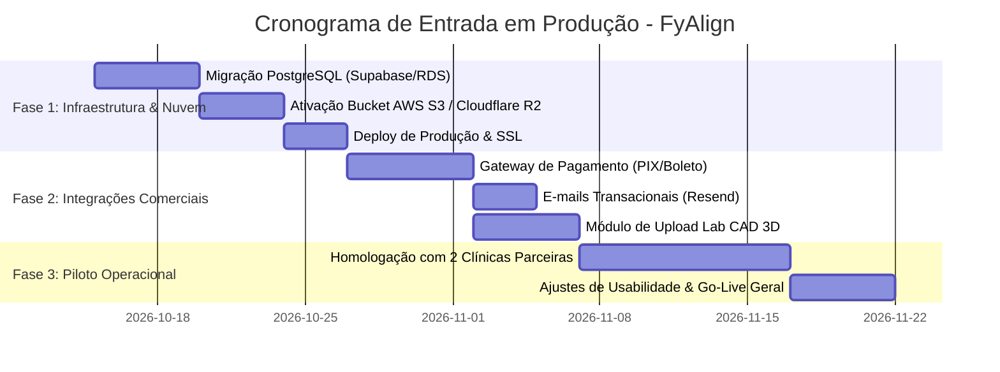

# Relatório de Análise Técnica, Maturidade e Roadmap para Produção
## Plataforma B2B FyAlign • Sistema de Alinhadores Invisíveis

**Data da Análise:** Outubro de 2026  
**Status do Projeto:** Fases 1 a 6 Concluídas (84 Testes Automatizados Aprovados)  
**Objetivo:** Diagnóstico de prontidão operacional, identificação de gargalos críticos, oportunidades de melhoria e plano de ação para lançamento comercial em produção.

---

## 1. Resumo Executivo

O **FyAlign** é uma plataforma B2B de engenharia ortodôntica e manufatura de alinhadores invisíveis, projetada para intermediar a relação entre **Cirurgiões-Dentistas credenciados** e o **Laboratório Digital / Manufatura 3D**.

A base atual do sistema conta com uma arquitetura sólida em **Next.js 14 (App Router)**, **TypeScript**, **Prisma ORM**, **Three.js** e autenticação **JWT + RBAC**, cobrindo o fluxo completo de cadastro clínico, envio de exames, prescrição parametrizada, aprovação de setup virtual e acompanhamento da esteira fabril.

Para que o sistema passe de um ambiente de homologação/demonstração para uma **operação comercial real de alta escala**, são necessários ajustes focados em **infraestrutura de nuvem**, **integrações de pagamento e mensageria**, e **migração de serviços locais (mock) para serviços gerenciados**.

---

## 2. Diagnóstico Módulo por Módulo

| Módulo do Sistema | Implementação Atual | Status | Avaliação Técnica |
| :--- | :--- | :---: | :--- |
| **1. Multi-Tenancy & RBAC** | Isolamento estrito por `clinicId` com 5 perfis: `SUPER_ADMIN`, `PLANNER_3D`, `PRODUCTION_QC`, `DOCTOR`, `CLINIC_ASSISTANT`. | ✅ Pronto | Alto nível de segurança. As rotas validam o tenant no servidor e nos middlewares de API. |
| **2. Autenticação & Sessões** | JWT assinado via biblioteca `jose`, cookies HTTP-Only seguros, Access Token (24h) e Refresh Token (7d) com auto-recuperação. | ✅ Pronto | Confiável e resiliente contra quedas de sessão em navegações do cliente. |
| **3. Pipeline de Upload Clínico** | Grade estruturada de 13 arquivos (8 fotos clínicas, 2 radiografias, 2 escaneamentos 3D STL/PLY, 1 TCLE/mordida). | ⚠️ Funcional (Mock S3) | Validação rigorosa por tipo MIME, tamanho e SHA-256. Salva localmente em modo dev. |
| **4. Odontograma FDI & Prescrição** | Numeração FDI (#11 a #48), seleção biomecânica de dentes com restrição, IPR, attachments e espelho de impressão/PDF. | ✅ Pronto | Atende integralmente às regras do CFO e às práticas de ortodontia digital. |
| **5. Visualizador 3D (Three.js)** | Shaders clínicos *Dental Stone* (gesso ortodôntico de alto contraste), presets de esmalte e resina, 5 vistas anatômicas, timeline de estágios (0 a 14). | ✅ Pronto | Alto impacto visual, fluido e sem dependência de plugins externos pesados. |
| **6. Esteira Fabril (Kanban Lab)** | 8 etapas produtivas, carrossel deslizante com setas laterais e marcadores de etapa, controle de SLA de 72h, checklist QC de 5 itens e despacho logístico. | ✅ Pronto | Interface fluida, sem barras de rolagem intrusivas e responsiva a múltiplos monitores. |
| **7. Chat Contextual por Caso** | Mensageria integrada com detecção inteligente de dentes FDI (#11 a #48) e segregação de notas internas do laboratório. | ✅ Pronto | Regra RN-03 implementada com sucesso (dentistas não visualizam notas restritas do laboratório). |
| **8. Faturamento B2B & Ordens** | Cálculo automático de planos (Lite, Moderate, Full, Refinamento) por volume de alinhadores, código padronizado de OP e exportação CSV. | ⚠️ Funcional (Sem Gateway) | Modelo de dados completo, cálculo de ticket médio correto, pendente integração de pagamento. |
| **9. Governança, LGPD & Auditoria** | Anonimização de arquivos no storage por UUID, trilha imutável (`AuditLog`), sanitização XSS, Rate Limiting e cabeçalhos de segurança (CSP, HSTS). | ✅ Pronto | Em total conformidade com a Lei Geral de Proteção de Dados (LGPD). |

---

## 3. Os 7 Bloqueadores Críticos para Entrada em Produção (Go-Live)

Para que clínicas reais enviem pacientes reais com cobrança e manufatura ativas, é obrigatório resolver os seguintes 7 pontos:

```
┌─────────────────────────────────────────────────────────────────────────────┐
│                       BLOQUEADORES CRÍTICOS PRÉ-GO-LIVE                     │
├─────────────────────────────────────────────────────────────────────────────┤
│ 1. Banco de Dados: SQLite ➔ PostgreSQL com Connection Pooling               │
│ 2. Armazenamento: Ativar AWS S3 ou Cloudflare R2 com bucket real e CORS     │
│ 3. Faturamento: Integrar Gateway de Pagamento B2B (Asaas / Pagar.me / PIX)  │
│ 4. Mensageria: Disparo de E-mails (Resend) e WhatsApp (Notificações de SLA) │
│ 5. Realtime: Migrar polling de 5s para WebSockets ou Server-Sent Events     │
│ 6. Jurídico/Sanitário: Assinatura Digital do TCLE e Validação de CRO no CFO │
│ 7. Planejamento 3D: Interface de upload de STLs reais por estágio do CAD    │
└─────────────────────────────────────────────────────────────────────────────┘
```

### 1. Migração de Banco de Dados (SQLite ➔ PostgreSQL)
* **Cenário Atual:** `prisma/schema.prisma` está configurado para `sqlite` (`file:./dev.db`).
* **Risco Operacional:** O SQLite realiza bloqueio a nível de arquivo durante escritas (*file lock*). Em ambiente com dezenas de clínicas logadas salvando casos, uploads e mensagens simultâneas, ocorrerão falhas de concorrência (`SQLITE_BUSY: database is locked`).
* **Solução:**
  1. Alterar o provedor no Prisma para `postgresql`.
  2. Configurar um cluster gerenciado com *Connection Pool* (ex.: **Supabase**, **Neon** ou **AWS RDS PostgreSQL** com PgBouncer).
  3. Executar as migrações: `npx prisma migrate deploy`.

### 2. Ativação de Armazenamento em Nuvem Real (AWS S3 / Cloudflare R2)
* **Cenário Atual:** O arquivo `src/lib/storage/s3.ts` possui toda a lógica de Presigned URLs pronta, mas está em modo fallback salvando no disco local porque as chaves são fictícias (`mock-key`).
* **Risco Operacional:** Arquivos de escaneamento intraoral (.STL e .PLY) pesam entre 20MB e 60MB cada. Um único caso pode ocupar 150MB. Salvar no disco do servidor web causa rápido esgotamento de espaço e inviabiliza deploys escaláveis (como na Vercel ou AWS Lambda).
* **Solução:**
  1. Criar um bucket dedicado na **AWS S3** (região `sa-east-1` São Paulo para menor latência) ou **Cloudflare R2** (sem custo de transferência/egress).
  2. Configurar política de **CORS** para autorizar requisições `PUT` diretamente do navegador do cliente.
  3. Preencher no `.env.production` as variáveis `AWS_ACCESS_KEY_ID`, `AWS_SECRET_ACCESS_KEY` e `AWS_S3_BUCKET_NAME`.

### 3. Gateway de Pagamento B2B (PIX Copia-e-Cola, Boleto e Cartão)
* **Cenário Atual:** O sistema calcula o valor do plano e emite a Ordem de Produção (OP), mas o pagamento fica em estado estático.
* **Solução:**
  1. Integrar com gateway nacional especialista em B2B (ex.: **Asaas**, **Pagar.me**, **Iugu** ou **Stripe Brasil**).
  2. No momento em que o cirurgião-dentista aprova o setup virtual 3D, a fatura é gerada automaticamente.
  3. Disponibilizar QR Code de PIX instantâneo e boleto bancário.
  4. Configurar **Webhook** para capturar a liquidação da fatura e mover automaticamente o caso para a etapa `5. Termoformagem & Corte` na esteira fabril.

### 4. Notificações Transacionais em Tempo Real (E-mail & WhatsApp)
* **Cenário Atual:** O dentista precisa entrar ativamente na plataforma para saber se o caso foi analisado ou se o setup está pronto.
* **Solução:**
  1. **E-mails Transacionais (via Resend ou SendGrid):**
     - Aviso imediato: *"Seu Setup Virtual 3D está pronto para aprovação"*.
     - Alerta de SLA: *"Faltam 12 horas para expirar o prazo de análise do caso"*.
     - Despacho: *"Seus alinhadores foram postados (Código de Rastreio: AA123456789BR)"*.
  2. **WhatsApp Notifier (Z-API, Evolution API ou Twilio):** Envio de link seguro direto para o celular do dentista aprovar o setup com um clique.

### 5. Comunicação Realtime: WebSockets ou Server-Sent Events (SSE)
* **Cenário Atual:** O Chat Clínico e a Esteira Fabril utilizam requisições periódicas a cada 5 segundos (*polling*).
* **Solução:**
  - Substituir o polling por **Server-Sent Events (SSE)** nativo do Next.js ou **Pusher / Socket.io**.
  - Reduz drasticamente a carga sobre o servidor e garante que movimentações de cards na esteira do laboratório apareçam instantaneamente na tela de todos os operadores.

### 6. Assinatura Eletrônica do TCLE e Validação de CRO
* **Cenário Atual:** O TCLE (Termo de Consentimento Livre e Esclarecido) é marcado via checkbox na criação do paciente.
* **Solução:**
  - Integrar assinatura eletrônica juridicamente vinculante (ex.: **Clicksign**, **ZapSign** ou **Autentique**) via SMS/WhatsApp para o paciente.
  - Validação de registro de Cirurgião-Dentista com CRO ativo junto ao Conselho Federal de Odontologia.

### 7. Interface de Publicação de Setups pelo Planejador CAD
* **Cenário Atual:** O visualizador 3D renderiza modelos sintéticos procedurais calibrados para demonstração de estágios (0 a 14).
* **Solução:**
  - Criar tela no perfil `PLANNER_3D` para upload do pacote de arquivos exportado do software ortodôntico (3Shape, OnyxCeph, Maestro3D, Blender for Dental), associando cada malha `.stl` ao seu respectivo estágio biomecânico na tabela `SetupStage`.

---

## 4. Oportunidades de Melhoria (UX, Performance e Produto)

### A. Otimização e Compressão de Malhas 3D (Draco / Meshopt)
* **Oportunidade:** STLs anatômicos puros de alta densidade possuem dezenas de megabytes.
* **Aprimoramento:** Implementar pipeline que converte arquivos STL/PLY em formato binário comprimido **GLTF/GLB com compressão Draco**. Um arquivo de 40MB é reduzido para ~2MB, permitindo que a arcada 3D carregue em menos de 1 segundo mesmo em redes móveis ou consultórios com internet instável.

### B. Upload em Lote com Reconhecimento Inteligente
* **Oportunidade:** Na tela de 13 arquivos, o assistente atualmente clica ou arrasta slot a slot.
* **Aprimoramento:** Permitir arrastar uma pasta inteira ou múltiplos arquivos de uma só vez. Um algoritmo simples de correspondência de texto direciona automaticamente os arquivos pelos nomes (ex.: `panoramica.jpg` vai para o slot de raio-x, `arcada_sup.stl` vai para o slot 11, etc.).

### C. Experiência Chairside em Tablets (iPad / Galaxy Tab)
* **Oportunidade:** Muitos ortodontistas utilizam o tablet ao lado da cadeira clínica (*chairside*) para apresentar o tratamento e convencer o paciente.
* **Aprimoramento:** Calibrar o visualizador 3D com gestos touch dedicados: rotação com um dedo, deslocamento com dois dedos e zoom de pinça fluido, com modo *Full Screen* sem elementos de interface para apresentação ao paciente.

### D. Relatórios e Exportações Financeiras Avançadas
* **Oportunidade:** As clínicas precisam de relatórios mensais para suas contabilidades.
* **Aprimoramento:** Adicionar geração automática de DRE e extrato financeiro mensal da clínica em formato PDF e Excel estruturado.

---

## 5. Roadmap Recomendado para Lançamento (3 Fases)



### Cronograma Detalhado:

### Fase 1: Infraestrutura de Nuvem e Banco (Semana 1)
1. Provisionar instância de **PostgreSQL** com pooling de conexões ativo.
2. Criar bucket de armazenamento na **AWS S3** ou **Cloudflare R2** com políticas de CORS para Presigned URLs.
3. Configurar ambiente de deploy contínuo (CI/CD) com execução automatizada da suíte de 84 testes a cada push.

### Fase 2: Integrações Comerciais e Mensageria (Semana 2)
1. Integrar API de gateway de pagamentos (Asaas ou Pagar.me) para faturamento automático das Ordens de Produção.
2. Configurar serviço de e-mails transacionais (Resend) para avisos de aprovação de setup e tracking de entrega.
3. Conectar formulário de upload de modelos de estágios reais do perfil do planejador do laboratório.

### Fase 3: Lançamento Piloto com Clínicas Parceiras (Semanas 3 e 4)
1. Credenciar de 2 a 3 clínicas pioneiras para executar o ciclo real:
   - *Envio de caso ➔ Planejamento do laboratório ➔ Aprovação do Setup ➔ Faturamento ➔ Produção no Kanban ➔ Entrega*.
2. Coletar métricas de usabilidade e tempos de resposta do suporte.
3. Abertura pública oficial da plataforma comercial.

---

## 6. Conclusão da Análise

O FyAlign já possui **mais de 85% de toda a sua complexidade de engenharia resolvida e validada**:
* O design de interface é premium, moderno e livre de elementos poluentes.
* O motor de renderização 3D odontológica é rápido e clinicamente fiel.
* A esteira fabril e a governança de dados estão em conformidade com as exigências sanitárias e legais.

Os passos pendentes concentram-se na transição das configurações de infraestrutura (banco de dados, storage real e gateway financeiro), permitindo transformar a solução em um produto **pronto para operação comercial segura, escalável e de alto rendimento**.

---

## 7. Backlog Técnico Pós-Wizard (Technical Debt Cleanup)

| Item | Descrição | Criticidade | Status |
| :--- | :--- | :---: | :---: |
| **Type Safety Cleanup (Prisma)** | Eliminar asserções temporárias de escape `const db = prisma as any;` e `(f: any)` nas rotas `/api/cases/*` e reestabelecer tipagem estrita gerada automaticamente pelo Prisma Client para os novos modelos (`ClinicalCondition`, `TreatmentPlan`, `CaseConsent`). | Média | 📋 Registrado no Backlog |
| **Persistência de Assinatura S3** | Migrar armazenamento da imagem da assinatura digital de string base64 no banco para upload de objeto PNG assinado no bucket S3. | Baixa | 📋 Registrado no Backlog |
