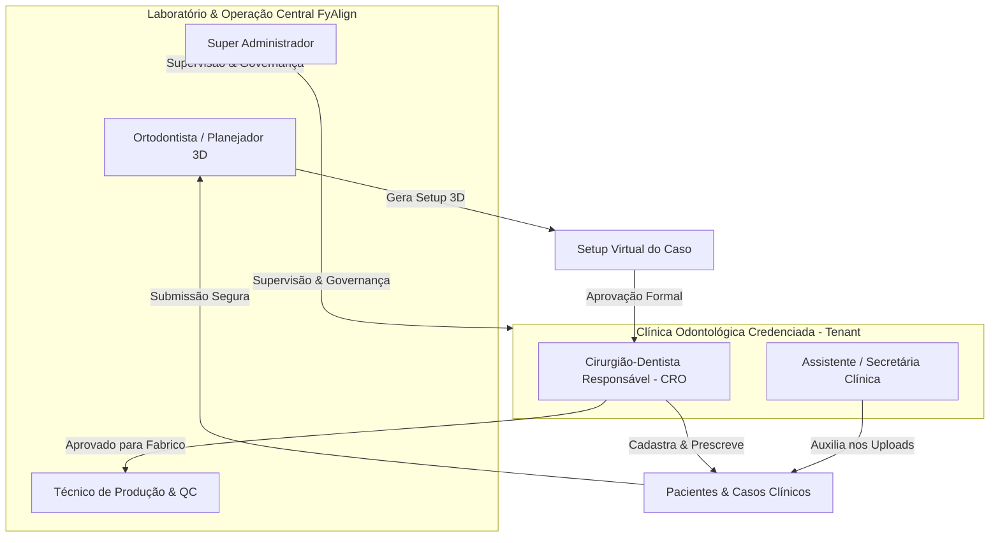
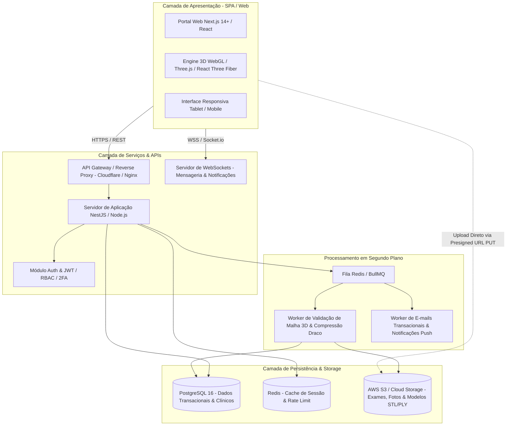
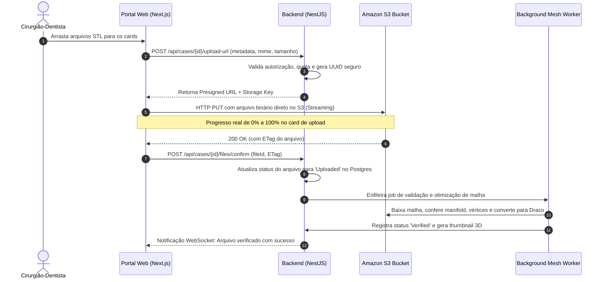
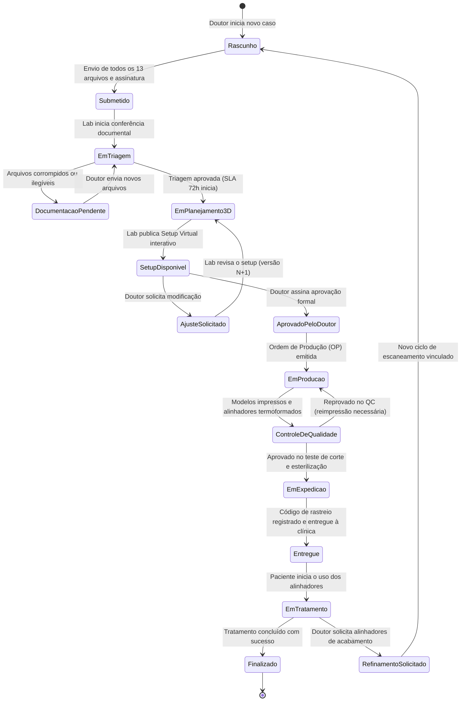
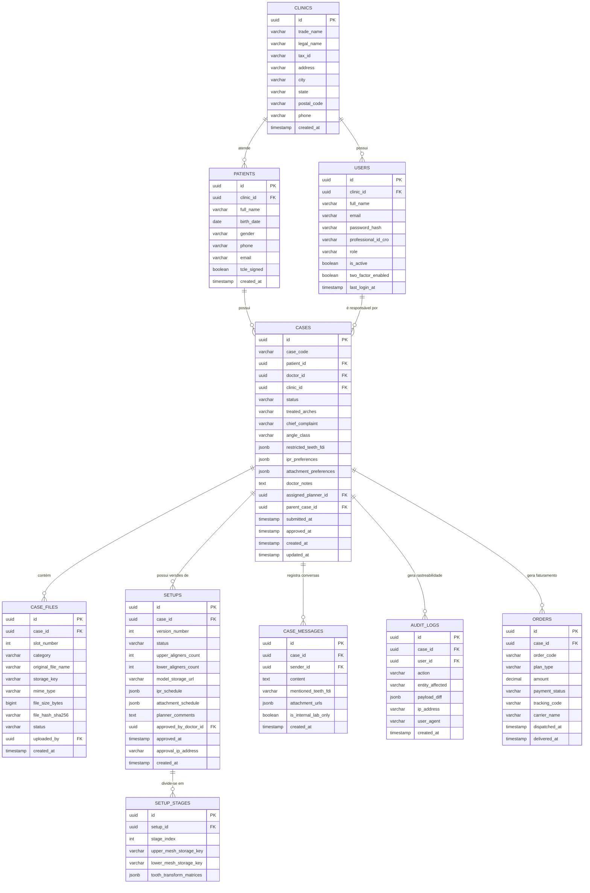
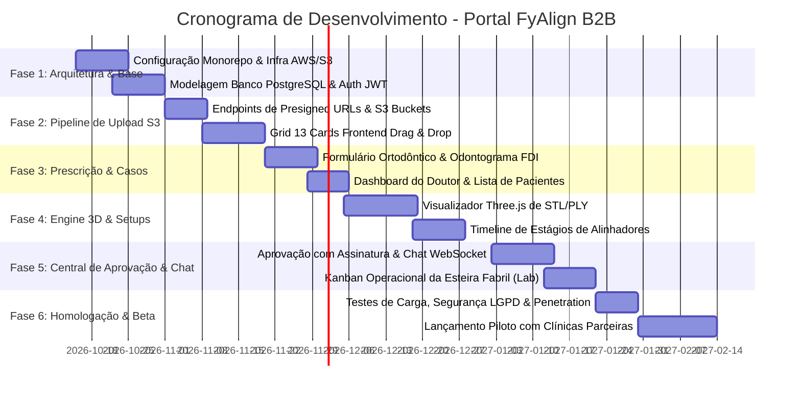

# Master BluePrint 2.0 - Plataforma B2B FyAlign
## Documento de Especificação Técnica, Funcional e Arquitetural Definitivo

---

## 1. Visão Geral e Objetivos do Produto

O **Portal FyAlign** é uma plataforma B2B corporativa em nuvem desenvolvida especificamente para conectar **Clínicas Odontológicas / Ortodontistas Credenciados** à **Equipe de Engenharia Clínica, Planejamento CAD 3D e Manufatura Aditiva (Laboratório FyAlign)**.

O objetivo primordial do sistema é eliminar a fragmentação de canais (WhatsApp, e-mails, WeTransfer e planilhas), garantindo:
1. **Padronização rigorosa do envio de documentação ortodôntica** (fotografias clínicas, exames radiológicos e escaneamentos intraorais 3D).
2. **Visualização e aprovação 3D interativa de Setups Virtuais** diretamente no navegador sem necessidade de softwares proprietários pesados instalados localmente.
3. **Comunicação ágil e contextualizada** entre doutores e planejadores por caso clínico.
4. **Rastreabilidade de ponta a ponta** do ciclo de vida dos alinhadores invisíveis (da anamnese à impressão 3D, termoformagem, controle de qualidade e expedição logística).
5. **Conformidade irrestrita com a LGPD/RGPD** e normas sanitárias do Conselho Federal de Odontologia (CFO).

---

## 2. Personas e Matriz de Acessos (RBAC)

O sistema opera sob uma arquitetura **Multi-Tenant por Clínica**, onde cada clínica possui sua própria equipe e pacientes, enquanto a FyAlign opera como gestora do laboratório central:



### Detalhamento dos Papéis:
- **Cirurgião-Dentista (Doutor Credenciado)**: Titular legal do caso. Preenche e assina a prescrição ortodôntica digital, revisa e aprova/rejeita setups 3D, interage no chat técnico e acompanha entregas.
- **Assistente / Secretária da Clínica**: Auxilia no fluxo operacional (cadastro básico do paciente e upload inicial de fotos/exames), mas **não possui permissão** para assinar prescrições ou aprovar formalmente planejamentos.
- **Planejador Ortodôntico 3D (FyAlign Lab)**: Analisa a documentação enviada, valida a viabilidade biomecânica da malha 3D, modela os estágios dos alinhadores em software CAD e publica o Setup Virtual interativo para aprovação do doutor.
- **Técnico de Produção e Controle de Qualidade (QC)**: Acessa arquivos de corte e modelos fatiados para impressão 3D em resina, termoformagem e embalagem, inserindo códigos de rastreamento logístico.
- **Super Administrador**: Controle global de faturamento, credenciamento de novos dentistas, métricas de SLA do laboratório e auditoria do sistema.

---

## 3. Arquitetura de Alto Nível do Sistema

A solução adota uma arquitetura em camadas orientada a eventos para uploads e comunicação em tempo real:



### Destaque Arquitetural: Pipeline de Upload Otimizado para Arquivos 3D
Para evitar gargalos de memória e timeout no servidor Node.js (comum quando múltiplos arquivos STL de 30-80 MB são transmitidos simultaneamente):
1. O frontend solicita à API uma URL pré-assinada (`Presigned URL`) para o arquivo pretendido.
2. A API valida o tipo de arquivo, limites e permissão do usuário e devolve uma URL segura temporária do S3.
3. O frontend realiza o upload **diretamente para a Amazon S3** via método `PUT`, emitindo progresso de bytes real (0% a 100%).
4. Ao concluir, o frontend notifica a API com o checksum/ETag; um webhook aciona a fila do worker para validação da integridade da malha 3D em background.



---

## 4. Engenharia de Requisitos

### 4.1 Requisitos Funcionais (RF)

| ID | Nome | Descrição Detalhada |
|---|---|---|
| **RF-01** | **Autenticação e Multi-Tenancy** | Autenticação via JWT (Access + Refresh Token HttpOnly), recuperação de senha com link seguro e 2FA via TOTP. Isolamento estrito de dados por clínica. |
| **RF-02** | **Gestão de Pacientes** | Cadastro completo de pacientes da clínica com validação de CPF/ID local, data de nascimento, histórico clínico, tags de status e consentimento registrado. |
| **RF-03** | **Prescrição Ortodôntica Parametrizada** | Formulário clínico inteligente: arcos a tratar (Superior, Inferior ou Ambos), queixa principal, classificação de Angle (I, II, III), objetivos do tratamento, diretrizes de IPR (permitido/bloqueado), diretrizes de attachments e observações. |
| **RF-04** | **Odontograma Interativo (FDI)** | Mapeamento interativo dos 32 dentes permanentes (11 a 48) permitindo ao dentista selecionar dentes anquilosados, implantes que não devem mover e dentes indicados para extração. |
| **RF-05** | **Grid de 13 Cards de Upload com Drag & Drop** | Interface em grade setorizada para recepção de exatamente 13 tipos de documentação: 3 fotos extraorais, 5 fotos intraorais, 2 radiografias e 3 escaneamentos 3D (Superior, Inferior e Registro Oclusal). |
| **RF-06** | **Validação e Feedback Visual de Upload** | Validação client-side e server-side de formatos permitidos (`.stl`, `.ply`, `.obj`, `.jpg`, `.png`, `.dcm`), limite de tamanho, barra de progresso percentual, thumbnail dinâmico e status visual em cores (azul = aguardando, verde = enviado, vermelho = erro). |
| **RF-07** | **Visualizador 3D WebGL Básico** | Renderização imediata dos modelos STL enviados das arcadas superior e inferior com controles de órbita 360°, rotação, pan, zoom e vistas anatômicas pré-definidas (Frontal, Oclusal Superior, Oclusal Inferior, Lateral Direita, Lateral Esquerda). |
| **RF-08** | **Visualizador 3D de Setup Virtual com Timeline** | Player interativo dos estágios de tratamento (Passo 0 até Alinhador Final), reprodução automática, controle deslizante de etapas, destaque visual de attachments em cor diferenciada e tabela/mapa de desgastes interproximais (IPR). |
| **RF-09** | **Central de Aprovação de Setup Virtual** | Módulo formal onde o dentista avalia o planejamento 3D proposto pelo laboratório, podendo realizar a **Aprovação Formal com Assinatura Eletrônica** (registrando IP, timestamp e hash do setup) ou **Solicitação de Ajuste Técnico** com apontamento de correções. |
| **RF-10** | **Chat Contextual por Caso Clínico** | Canal de mensagens em tempo real integrado à tela do paciente entre o cirurgião-dentista e o planejador ortodôntico, suportando menções a dentes específicos (ex: `#21`), anexos de imagens e notificações instantâneas. |
| **RF-11** | **Painel Kanban da Esteira Fabril (Laboratório)** | Visão para a equipe FyAlign acompanhar casos em colunas: Triagem -> Planejamento CAD -> Aguardando Aprovação -> Impressão 3D -> Termoformagem & Laser -> Controle de Qualidade (QC) -> Expedição -> Concluído. |
| **RF-12** | **Rastreamento Logístico e Envio** | Cadastro de transportadora, código de rastreamento e endereço de entrega selecionado, com notificações de despacho e previsão de chegada. |
| **RF-13** | **Fluxo de Refinamento Vinculado** | Permite ao doutor abrir uma solicitação de alinhadores de refinamento vinculada ao caso original, herdando a anamnese e solicitando novos escaneamentos atualizados. |
| **RF-14** | **Auditoria e Logs de Atividades** | Registro inalterável de todas as ações sensíveis no sistema (downloads de exames, submissão de caso, alterações de status e aprovações de tratamento). |

### 4.2 Requisitos Não-Funcionais (RNF)

| ID | Categoria | Especificação |
|---|---|---|
| **RNF-01** | **Desempenho da Aplicação** | Tempo de carregamento inicial (FCP) < 1.2s; respostas de API em rotas de consulta < 200ms (p95). |
| **RNF-02** | **Desempenho Gráfico 3D** | Renderização WebGL estável a 60 FPS em hardware integrado padrão; compressão de malha 3D com Draco reduzindo o tamanho do arquivo em até 70%. |
| **RNF-03** | **Segurança de Dados** | Criptografia em trânsito com TLS 1.3 obrigatório (HSTS ativo); criptografia de dados em repouso com AES-256 no banco e buckets de armazenamento. |
| **RNF-04** | **Privacidade e LGPD** | Anonimização de nomes de pacientes nos storages: todos os arquivos salvos recebem nomes do tipo `UUIDv4.ext`. Particionamento lógico de arquivos por `clinic_id/case_id/`. |
| **RNF-05** | **Alta Disponibilidade** | Disponibilidade mínima garantida de 99.9% com monitoramento contínuo de uptime e alertas automáticos de degradação. |
| **RNF-06** | **Escalabilidade de Armazenamento** | Arquitetura de upload desacoplada suportando centenas de uploads concorrentes de 100 MB sem onerar a CPU dos servidores de aplicação. |
| **RNF-07** | **Compatibilidade e Responsividade** | Totalmente operacional nos navegadores Google Chrome, Safari, Firefox e Edge; visualizador 3D otimizado com suporte a toque para tablets (iPad / Android). |
| **RNF-08** | **Retenção e Conformidade Médica** | Manutenção dos registros de exames e logs de aprovação clínica por no mínimo 5 anos conforme exigências sanitárias e regulatórias odontológicas. |

### 4.3 Regras de Negócio (RN)

- **RN-01 (Mínimo Mandatório de Submissão)**: É terminantemente proibido enviar um caso para planejamento sem o preenchimento de todos os campos obrigatórios da prescrição, dos 2 escaneamentos 3D (Superior e Inferior) e das fotos clínicas mandatórias.
- **RN-02 (Assinatura Exclusiva do Doutor)**: Apenas usuários cadastrados com papel de Cirurgião-Dentista e CRO verificado possuem autorização para assinar a prescrição clínica e aprovar o Setup Virtual. Assistentes não têm acesso a essa função.
- **RN-03 (Imutabilidade pós-Aprovação)**: Quando um Setup é aprovado pelo doutor, o caso entra imediatamente em modo de leitura (`locked/read-only`). Nenhuma foto, STL ou parâmetro pode ser alterado sem a reabertura formal do ciclo pelo suporte técnico.
- **RN-04 (SLA de Planejamento 3D)**: O laboratório FyAlign tem como compromisso a entrega da primeira versão do Setup Virtual em até **72 horas úteis** após a validação bem-sucedida da triagem técnica.
- **RN-05 (Consentimento LGPD/TCLE)**: O dentista deve obrigatoriamente marcar a confirmação de ciência de guarda do Termo de Consentimento Livre e Esclarecido (TCLE) assinado pelo paciente antes da transmissão dos exames.

---

## 5. Especificação Detalhada da Grid de 13 Cards de Upload

Para corrigir o salto de numeração do documento original e contemplar as necessidades da ortodontia moderna, a interface de envio adota uma matriz estruturada de exatamente 13 cards com dropzone individual:

```
┌─────────────────────────────────────────────────────────────────────────────────────────────────┐
│ SEÇÃO 1: FOTOGRAFIAS EXTRAORAIS (FACIAIS)                                                       │
├───────────────────────────────┬─────────────────────────────────┬───────────────────────────────┤
│ [Card 01]                     │ [Card 02]                       │ [Card 03]                     │
│ Foto Frontal em Repouso       │ Foto Frontal Sorrindo           │ Foto Perfil Direito (90°)     │
│ Formato: JPG / PNG (Máx 25MB) │ Formato: JPG / PNG (Máx 25MB)   │ Formato: JPG / PNG (Máx 25MB) │
├───────────────────────────────┴─────────────────────────────────┴───────────────────────────────┤
│ SEÇÃO 2: FOTOGRAFIAS INTRAORAIS (ARCADAS & MORDIDA)                                             │
├───────────────────────────────┬─────────────────────────────────┬───────────────────────────────┤
│ [Card 04]                     │ [Card 05]                       │ [Card 06]                     │
│ Oclusão Frontal (Mordida)     │ Oclusão Lateral Direita         │ Oclusão Lateral Esquerda      │
│ Formato: JPG / PNG (Máx 25MB) │ Formato: JPG / PNG (Máx 25MB)   │ Formato: JPG / PNG (Máx 25MB) │
├───────────────────────────────┼─────────────────────────────────┼───────────────────────────────┤
│ [Card 07]                     │ [Card 08]                       │                               │
│ Oclusal Arcada Superior       │ Oclusal Arcada Inferior         │                               │
│ Formato: JPG / PNG (Máx 25MB) │ Formato: JPG / PNG (Máx 25MB)   │                               │
├───────────────────────────────┴─────────────────────────────────┴───────────────────────────────┤
│ SEÇÃO 3: EXAMES RADIOLÓGICOS                                                                    │
├────────────────────────────────────────────────┬────────────────────────────────────────────────┤
│ [Card 09]                                      │ [Card 10]                                      │
│ Radiografia Panorâmica                         │ Telerradiografia Lateral / Cefalométrica       │
│ Formato: JPG / PNG / DICOM (Máx 50MB)          │ Formato: JPG / PNG / DICOM (Máx 50MB)          │
├────────────────────────────────────────────────┴────────────────────────────────────────────────┤
│ SEÇÃO 4: ESCANEAMENTOS INTRAORAIS TRIDIMENSIONAIS (3D)                                          │
├───────────────────────────────┬─────────────────────────────────┬───────────────────────────────┤
│ [Card 11]                     │ [Card 12]                       │ [Card 13]                     │
│ Modelo 3D Arcada Superior     │ Modelo 3D Arcada Inferior       │ Registro Oclusal / Bite Scan  │
│ Formatos: .STL / .PLY / .OBJ  │ Formatos: .STL / .PLY / .OBJ    │ Formatos: .STL / .PLY (Opc.)  │
│ Visualizador 3D Integrado     │ Visualizador 3D Integrado       │ Articulação de Mordida        │
└───────────────────────────────┴─────────────────────────────────┴───────────────────────────────┘
```

### Estados Visuais de Cada Card:
1. **Pendente (Aguardando Ficheiro)**:
   - Borda tracejada em cinza-azulado (`#334155`).
   - Ícone central em azul ciano (`#0EA5E9`).
   - Rótulo claro com o ângulo clínico desejado.
   - Botão secundário "Selecionar Ficheiro" e área receptiva de Drag & Drop.
2. **Carregando (Upload em Andamento)**:
   - Animação de pulsar sutil.
   - Barra de progresso linear contínua com indicação percentual em tempo real (ex: `64% - 18.2 MB / 28.4 MB`).
   - Botão para cancelar upload.
3. **Concluído (Enviado com Sucesso)**:
   - Borda sólida em azul marinho com badge superior verde esmeralda (`#10B981`) "Enviado".
   - Miniatura gerada automaticamente (thumbnail da foto ou render 3D isométrico).
   - Nome original do arquivo (truncado com reticências), tamanho em KB/MB.
   - Ações: Ícone de olho (abrir prévia em alta resolução ou modal 3D), substituir arquivo e excluir.
4. **Erro / Inconsistência**:
   - Borda em vermelho carmim (`#EF4444`) com badge "Falha no Envio".
   - Mensagem explicativa (ex: "Arquivo excede 25 MB" ou "Malha 3D não-manifold detectada").
   - Botão em destaque "Tentar Novamente".

---

## 6. Máquina de Estados do Caso Clínico (Lifecycle)

O fluxo operacional de um caso na plataforma FyAlign obedece rigorosamente a 12 etapas com transições controladas:



---

## 7. Modelo de Dados Relacional (DER)

O banco de dados relacional (PostgreSQL) é estruturado para suportar escalabilidade, versionamento de arquivos e auditoria total:



---

## 8. Especificação da Engine do Visualizador 3D (Three.js)

O módulo de visualização 3D é um componente central para a experiência do usuário, construído sobre **Three.js** e **React Three Fiber**:

### 8.1 Funcionalidades da Engine 3D:
1. **Suporte a Formatos**: Leitura de `.STL` (binário e ASCII), `.PLY` (com suporte a cores de superfície escaneadas) e `.OBJ`.
2. **Compressão Draco & WebAssembly**: Os arquivos de setup publicados pelo laboratório são convertidos em segundo plano para o formato comprimido Draco (`.glb` / `.drc`), reduzindo o tempo de download inicial para menos de 3 segundos em conexões convencionais.
3. **Controle de Iluminação & Shaders Odontológicos**:
   - Shader de esmalte dental semi-translúcido com reflexo especular suave.
   - Shader diferenciado para gengiva / tecido mole.
   - Cor de destaque para attachments de resina composta (ex: ciano ou amarelo translúcido).
   - Mapa de cores (Heatmap) opcional indicando pontos de contato oclusal excessivo (vermelho = contato forte, azul = sem contato).
4. **Timeline Interativa de Estágios (Alinhador 0 ao Alinhador N)**:
   - Barra de reprodução com botões de *Play*, *Pause*, *Próximo Estágio*, *Estágio Anterior*.
   - Slider contínuo com transição suave (interpolação de matrizes de transformação por dente).
   - Modo de comparação instantânea "Antes x Depois" (Sobreposição com controle de opacidade).
5. **Câmera e Vistas Rápidas**:
   - Botões pré-definidos: `Frontal`, `Oclusal Superior`, `Oclusal Inferior`, `Lateral Direita`, `Lateral Esquerda`, `Molar Oclusão`.
   - Alternância independente de visibilidade da Arcada Superior e Arcada Inferior (visão isolada ou articulada).

---

## 9. Design System e Diretrizes de UI/UX

A identidade visual transmite autoridade médica, tecnologia de ponta e facilidade operacional:

### 9.1 Paleta de Cores

| Nome da Cor | Código Hexadecimal | Finalidade no Sistema |
|---|---|---|
| **Deep Navy (Fundo Principal)** | `#0A192F` | Barra de navegação lateral (Sidebar), rodapés e cabeçalhos escuros institucionais. |
| **Slate Dark (Fundo de Cards/Paineis)** | `#0F172A` / `#1E293B` | Superfície de cards, formulários e modais em modo escuro/tecnológico. |
| **Electric Cyan (Cor de Destaque)** | `#00D2D3` / `#0EA5E9` | Botões primários de ação, ícones em foco, barras de progresso ativas e links. |
| **Mint Emerald (Sucesso/Aprovado)** | `#10B981` | Badges de status "Enviado", "Setup Aprovado", arquivos conferidos com sucesso. |
| **Amber Gold (Atenção/Em Espera)** | `#F59E0B` | Status "Em Planejamento", "Aguardando Aprovação", advertências clínicas leves. |
| **Crimson Coral (Erro/Rejeição)** | `#EF4444` | Badges de "Erro de Upload", "Ajuste Solicitado", dentes restritos no odontograma. |
| **Neutral Canvas (Modo Claro - Área Clínica)** | `#F8FAFC` / `#FFFFFF` | Fundo principal da área de prontuário para máxima legibilidade de textos e exames. |

### 9.2 Princípios de Interação
- **Microinterações Fluidas**: Feedback visual em menos de 100ms para qualquer ação do mouse (hover em cards, ativação de dropzones com mudança de tonalidade e escala sutil).
- **Sem Modais Bloqueantes Desnecessários**: Uploads de arquivos ocorrem em segundo plano enquanto o dentista pode continuar preenchendo as observações da anamnese.
- **Odontograma FDI Reativo**: Clicar no número de um dente (ex: `#16`) alterna seu status visual entre "Normal", "Não Movimentar (Implante/Prótese)" e "Extração Planejada".

---

## 10. Segurança, Compliance e LGPD Odontológica

Por lidar com dados de saúde (dados pessoais sensíveis conforme a Lei nº 13.709/2018 - LGPD e Resoluções do CFO):

1. **Anonimização no Armazenamento**:
   - Nenhum arquivo armazenado na AWS S3 contém o nome do paciente, CPF ou identificação pessoal na URL ou no nome do objeto.
   - O caminho de armazenamento segue a máscara estrita: `s3://fyalign-prod-vault/{clinic_uuid}/{case_uuid}/{file_uuid}.{ext}`.
2. **Termo de Consentimento Livre e Esclarecido (TCLE)**:
   - Checkbox mandatório gravado com timestamp, versão do termo e identificação do usuário da clínica que efetuou a submissão.
3. **Controle Estrito de Sessão e Tokens**:
   - Tokens JWT com tempo de expiração curto (15 minutos para Access Token, 7 dias para Refresh Token armazenado em Cookie `HttpOnly` com flag `SameSite=Strict` e `Secure`).
4. **Trilha de Auditoria Imutável (Audit Trail)**:
   - Toda visualização de imagem, download de modelo 3D ou alteração de status de caso gera um registro na tabela `audit_logs` contendo IP do cliente, User-Agent, ID do usuário e data/hora em UTC.

---

## 11. Especificação dos Principais Endpoints da API REST

A API do backend segue o padrão RESTful com documentação OpenAPI / Swagger:

### Autenticação & Clínicas
- `POST /api/v1/auth/login` - Autenticação com e-mail e senha (retorna JWT).
- `POST /api/v1/auth/refresh` - Renovação de token de acesso via Cookie seguro.
- `GET /api/v1/clinics/me` - Dados da clínica logada, endereços e equipe.

### Casos Clínicos & Prescrição
- `GET /api/v1/cases` - Lista casos da clínica (com filtros por status, paciente e paginação).
- `POST /api/v1/cases` - Cria um novo rascunho de caso clínico.
- `GET /api/v1/cases/:id` - Detalhes completos do caso, prescrição, histórico e arquivos.
- `PATCH /api/v1/cases/:id/prescription` - Atualiza a prescrição ortodôntica e odontograma.
- `POST /api/v1/cases/:id/submit` - Submissão final do caso para o laboratório (valida se os 13 arquivos mandatórios estão presentes).

### Mídia & Upload S3
- `POST /api/v1/cases/:id/upload-url` - Gera Presigned URL temporária para o S3 para um slot específico (1 a 13).
  - *Payload*: `{ "slotNumber": 11, "fileName": "arcada_sup.stl", "mimeType": "model/stl", "fileSize": 45120300 }`
  - *Retorno*: `{ "uploadUrl": "https://s3.amazonaws.com/...", "storageKey": "...", "fileId": "uuid" }`
- `POST /api/v1/cases/:id/files/:fileId/confirm` - Confirma a conclusão do upload direto no S3 com o hash recebido.
- `DELETE /api/v1/cases/:id/files/:fileId` - Remove um arquivo de rascunho.

### Setups 3D & Aprovação
- `GET /api/v1/cases/:id/setups` - Histórico de versões do Setup Virtual 3D.
- `POST /api/v1/cases/:id/setups/:setupId/approve` - Aprovação formal do setup pelo Cirurgião-Dentista.
- `POST /api/v1/cases/:id/setups/:setupId/reject` - Solicitação de ajustes com apontamentos técnicos.

### Comunicação & Chat
- `GET /api/v1/cases/:id/messages` - Histórico de mensagens do caso.
- `POST /api/v1/cases/:id/messages` - Envio de nova mensagem no chat (notifica via WebSocket).

---

## 12. Roteiro de Implementação e Entregas (Roadmap)



### Fases Detalhadas:
1. **Fase 1 (Fundação & Multi-Tenancy)**: Setup do banco de dados, tabelas relacionais, migrations, isolamento por clínica e autenticação JWT com controle de perfis (RBAC).
2. **Fase 2 (Pipeline de Upload de Alta Performance)**: Implementação do upload direto para Amazon S3 via Presigned URLs, frontend da Grid de 13 Cards com botão de inserir e Drag & Drop, barras de progresso e validação de MIME types.
3. **Fase 3 (Prescrição Ortodôntica Inteligente)**: Construção da anamnese digital interativa, seletor de objetivos de tratamento e Odontograma visual em notação FDI (11 a 48).
4. **Fase 4 (Engine 3D & Visualizador WebGL)**: Integração do Three.js / React Three Fiber, renderização de malhas STL/PLY, compressão Draco e reprodução dos estágios do setup virtual.
5. **Fase 5 (Colaboração & Esteira do Laboratório)**: Central de aprovação digital de setups, canal de chat em tempo real por caso, painel Kanban para a equipe da FyAlign e módulo de expedição logística.
6. **Fase 6 (Testes, Compliance & Lançamento)**: Auditoria de conformidade LGPD, testes de estresse de uploads concorrentes e lançamento piloto controlado com os primeiros 10 cirurgiões-dentistas parceiros.
